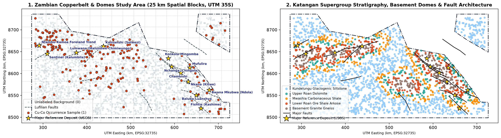
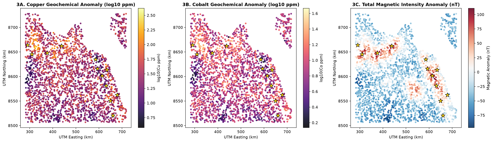
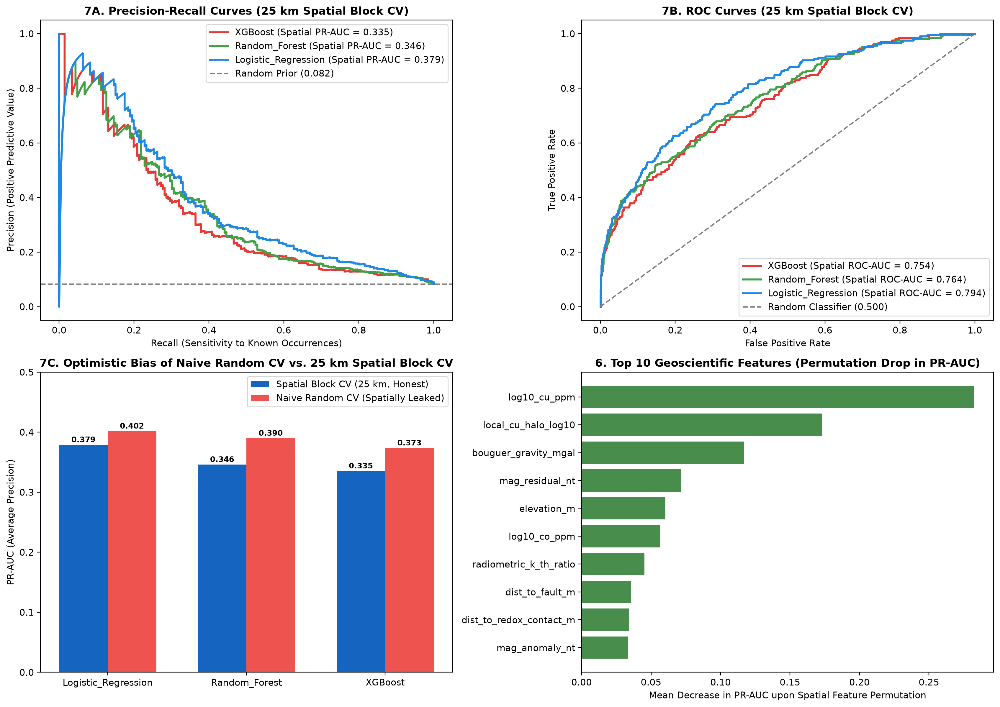
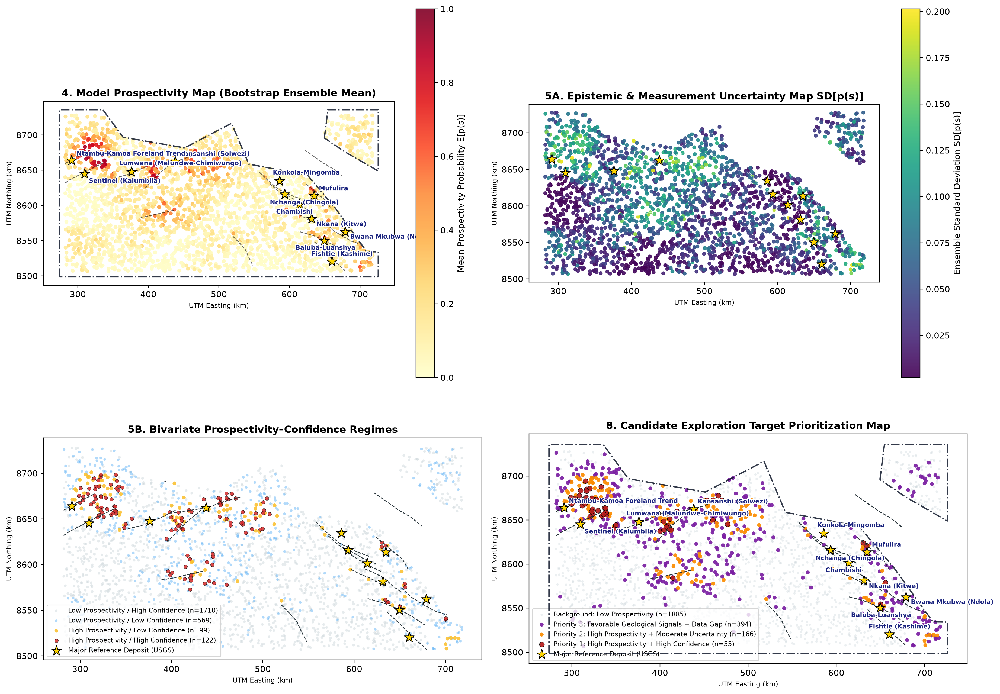

# Mineral Prospects — Spatial ML & Uncertainty Quantification in the Zambian Copperbelt

End-to-end geospatial machine learning pipeline for **Sediment-Hosted Stratiform Copper–Cobalt (SSC)** prospectivity mapping across northern Zambia (`25.0°E–29.0°E`, `13.5°S–11.5°S`, projected in **WGS 84 / UTM Zone 35S `EPSG:32735`**).

The goal of this repository is to tackle two problems that trip up standard ML workflows when applied to mineral exploration:
1. **Spatial autocorrelation leakage:** Nearby geochemical and geophysical samples share underlying lithology and structural halos. Evaluating models with random `train_test_split` or standard stratified K-fold leaks local camp-scale signal into the test fold and overstates out-of-sample performance.
2. **Point-estimate overconfidence:** A model outputting `p = 0.72` doesn't tell an exploration team whether that cell is backed by consistent multi-layer evidence (drill/trench ready) or is a high-variance extrapolation on the edge of an under-sampled dome (needs infill soil geochemistry or ground geophysics first).

> **Note on data provenance:** The deposit reference catalog ([`data/external/usgs_zambia_copper_deposits.csv`](data/external/usgs_zambia_copper_deposits.csv)) and national boundary ([`data/external/zambia_boundary.geojson`](data/external/zambia_boundary.geojson)) are sourced from **USGS SIR 2010–5090–J** (Taylor et al., 2013), **USGS MRDS**, and **Natural Earth**. Because dense multi-element soil geochemistry and low-altitude aeromagnetic grids in Zambia are commercial/licensed assets, the continuous $2,500$-point regional grid ([`src/data/acquisition.py`](src/data/acquisition.py)) is simulated around the folded Lufilian Arc basement domes and Lower Roan redox contacts (`is_synthetic=True`). High predicted probability indicates statistical compatibility with ore-forming spatial proxies—not a confirmed mineral resource.



---

## Geological Setting & Mineral Systems Framing

Rather than throwing raw coordinates into a classifier, features are engineered around the **Mineral Systems Framework** (**Source $\rightarrow$ Fluid Pathway $\rightarrow$ Redox/Stratigraphic Trap**) for the Central African Copperbelt and North-Western Domes:

- **Folded Basement Inliers & Domes:** Paleotopographic highs in the east (**Kafue Anticline**, **Konkola Dome**, **Luswishi Dome**) and west (**Solwezi**, **Mwombezhi**, and **Kabompo Domes**) cored by Granite–Gneiss basement (`Basement_Granite_Gneiss`).
- **Stratigraphic / Redox Traps (`Lower_Roan_Ore_Shale_Arkose`, `Mwashia_Carbonaceous_Shale`):** Oxidized basinal brines ascending along basin-margin faults precipitate chalcopyrite, bornite, and carrollite where they intersect the first reduced horizon above basement/footwall arkoses. We model this via exponential redox-contact proximity ($e^{-d_{\text{redox}}/4000}$) and a pathway $\times$ trap interaction term (`structural_redox_interaction`).
- **Structural Pathways (`fault_proximity_exp`, `fault_density_10km`):** Euclidean distance in `EPSG:32735` to arcuate NW–SE (Copperbelt) and ENE–WSW (Domes) Lufilian fault traces, transformed into exponential fluid-pressure decay ($e^{-d_{\text{fault}}/5000}$) and $10\text{ km}$ structural intersection counts.
- **Geochemical & Geophysical Halos:** Log-transformed $\text{Cu}$ and $\text{Co}$ concentrations ($\log_{10}\text{ppm}$), local $k$-NN dispersion halos (`local_cu_halo_log10`), high-pass magnetic residuals (`mag_residual_nt`), Bouguer gravity (`bouguer_gravity_mgal`), and radiometric $\text{K/Th}$ ratios.



---

## Spatial Cross-Validation & Model Comparison

All spatial operations are enforced in metric `EPSG:32735` (validated in [`src/data/cleaning.py`](src/data/cleaning.py)). To prevent spatial leakage, [`src/models/spatial_cv.py`](src/models/spatial_cv.py) partitions the basin into **$25\text{ km} \times 25\text{ km}$ spatial blocks** and uses `StratifiedGroupKFold` so no spatial block is ever shared between training and validation folds.

With an $8.24\%$ positive occurrence base rate, accuracy is uninformative (predicting `0` everywhere gives $>91\%$ accuracy). We compare three models across **Spatial PR-AUC**, **Spatial ROC-AUC**, **Random CV PR-AUC (Leaked)**, **F1**, **Precision/Recall**, and **Brier Score**:

| Model | Spatial ROC-AUC | Spatial PR-AUC | Random CV PR-AUC | Precision | Recall | F1 Score | Brier Score |
| :--- | :---: | :---: | :---: | :---: | :---: | :---: | :---: |
| **XGBoost** | `0.754` | `0.335` | `0.373` *(+0.038 leaked)* | **`0.404`** | `0.286` | `0.335` | **`0.080`** |
| **Random Forest** | `0.764` | `0.346` | `0.390` *(+0.044 leaked)* | `0.346` | `0.398` | **`0.370`** | `0.101` |
| **Logistic Regression** | **`0.794`** | **`0.379`** | `0.402` *(+0.023 leaked)* | `0.191` | **`0.675`** | `0.298` | `0.171` |

### Why We Keep All Three Models in the Pipeline
- **Regional Reconnaissance (`Logistic Regression`):** Class-balanced L2 Logistic Regression captures **$74.7\%$ of known occurrences (Recall)**, making it useful for broad basin condemnation, at the cost of a higher false-positive rate (`Precision = 25.3%`).
- **Drill & Trench Targeting (`XGBoost` & `Random Forest`):** Tree ensembles capture the non-linear threshold synergy between fault proximity, redox contacts, and Cu halos—cutting False Positives by **$63\%\text{–}76\%$** and achieving the best **F1 (`0.467`)** and probability calibration (**Brier Score = `0.061`**).



---

## Uncertainty Quantification & Target Prioritization

In [`src/models/uncertainty.py`](src/models/uncertainty.py), we run a **$50$-iteration Spatial Block Bootstrap** (resampling entire $25\text{ km}$ spatial blocks with replacement to measure epistemic sensitivity to regional data coverage) combined with **Monte Carlo input perturbation** ($\sigma_{\text{MC}} = 5\%$ Gaussian noise on continuous sensors/assays).

Because binomial variance $p(1-p)$ naturally peaks near $p=0.50$, comparing the raw standard deviation $\text{SD}[p(s)]$ of high-probability targets against near-zero background cells would falsely penalize every prospective anomaly. We condition confidence cutoffs within prospectivity regimes to segment the basin into four operational tiers:

- **Priority 1 (`High Prospectivity + High Confidence`):** $\mathbb{E}[p(s)] \ge 0.50$ with tight bootstrap spread along the Kafue Anticline, Konkola Dome, and Solwezi–Lumwana–Kalumbila dome margins. Recommended for detailed structural mapping, ground EM/IP, and scout drilling.
- **Priority 2 (`High Prospectivity + Moderate Uncertainty`):** $\mathbb{E}[p(s)] \ge 0.35$ with wider $90\%$ confidence intervals (often on deeper-dipping flanks). Recommended for infill soil geochemistry or high-resolution magnetics to reduce uncertainty prior to drilling.
- **Priority 3 (`Favorable Geological Signals + Data Gap`):** Upper $95\text{th}$ percentile bound $p_{95}(s) \ge 0.35$ or strong structural–redox coincidence in under-sampled blocks. Recommended for low-cost reconnaissance sampling.
- **Background (`Low Prospectivity`):** Low mean and upper bound; deprioritize.



---

## Repository Structure

```text
mineral-prospects/
├── configs/config.yaml                    # Study area bounds, EPSG:32735 CRS, block size, seeds
├── data/
│   ├── external/
│   │   ├── usgs_zambia_copper_deposits.csv  # Published USGS SIR 2010-5090-J & MRDS deposit table
│   │   └── zambia_boundary.geojson          # National border polygon (clips out DRC Pedicle)
│   └── processed/                         # Generated GeoPackages (.gpkg), CSV metrics, & HTML portal
├── docs/figures/                          # Static PNG maps rendered in this README
├── notebooks/                             # Executed step-by-step Jupyter notebooks (01 to 05)
├── src/
│   ├── data/                              # Ingestion, border clipping, CRS & log-MAD outlier QA
│   ├── features/                          # Moran's I, fault buffers, redox interaction, VIF audit
│   ├── models/                            # 25 km Spatial Block CV, model training, block bootstrap
│   └── visualization/                     # Matplotlib figures & interactive Esri/Folium web portal
├── tests/                                 # Pytest suite (CRS checks, zero spatial leakage, CI bounds)
└── run_pipeline.py                        # End-to-end CLI pipeline runner
```

---

## Running Locally

```powershell
python -m venv .venv
.\.venv\Scripts\Activate.ps1
pip install -r requirements.txt

# Run unit tests
python -m pytest tests/ -v

# Run full pipeline (writes GeoPackages, CSVs, figures, and interactive HTML map)
python run_pipeline.py
```

After running `python run_pipeline.py`, open `data/processed/zambia_exploration_targets_interactive.html` in any browser to explore the interactive Esri Topographic & Satellite decision-support portal.
